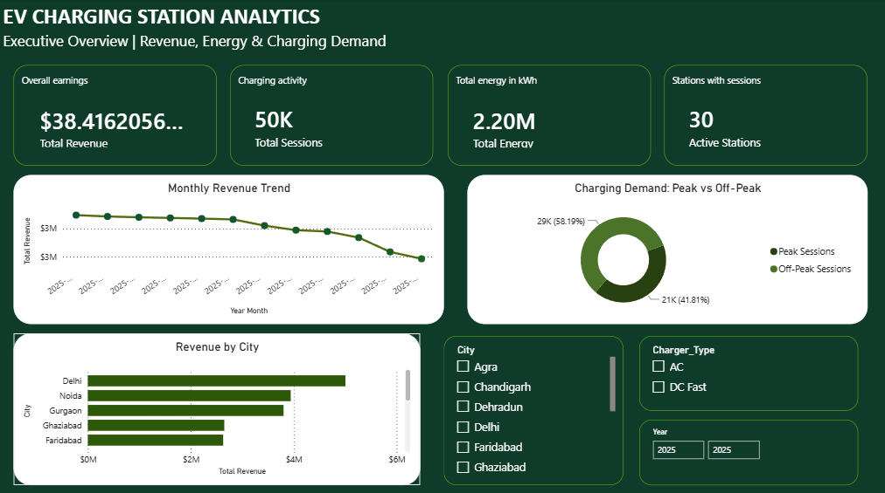
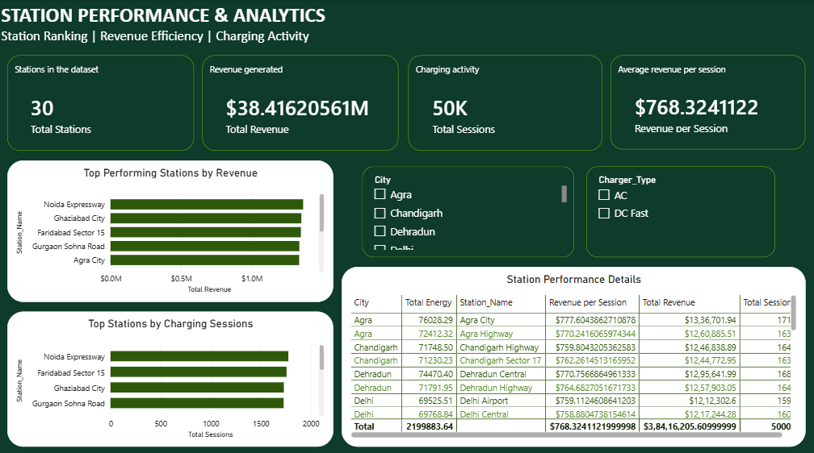
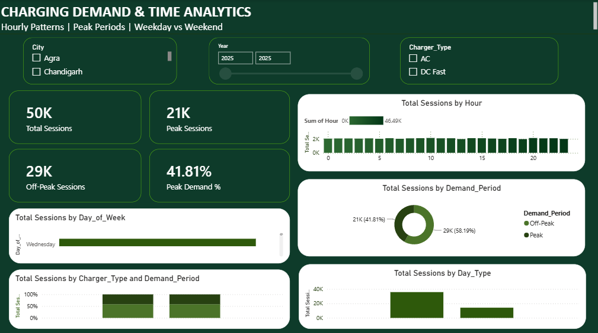
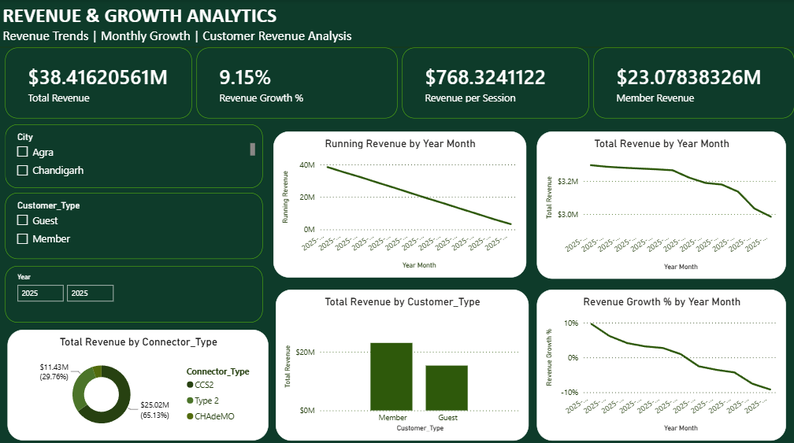
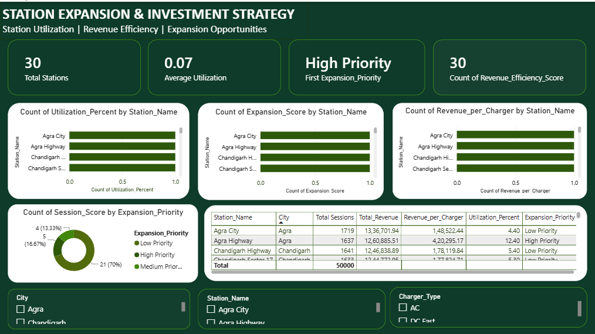

# EV_Charging_Intelligence_&_Revenue_Optimization

An end-to-end data analytics project focused on EV charging demand, revenue performance, station utilization, and expansion planning using Python, SQL, and Power BI.

## Project Overview

Electric vehicle charging networks need to understand charging demand, revenue trends, station performance, and opportunities to improve operational efficiency.

**EV Charging Intelligence & Revenue Optimization** is a data analytics project that explores EV charging session data to identify patterns in charging activity, compare station performance, analyze revenue, and support data-driven expansion planning.

The project covers the complete analytics workflow, including data preparation, exploratory data analysis, SQL analysis, KPI development, and interactive Power BI dashboards.

### Project Highlights

- Analyzed a dataset containing **50,000+ EV charging sessions across 30 charging stations**.
- Used Python, Pandas, and NumPy for data preparation and exploratory analysis.
- Applied SQL aggregations, Common Table Expressions (CTEs), and window functions for business analysis.
- Developed five Power BI dashboard pages covering different aspects of EV charging operations.
- Used KPIs, filters, and visual comparisons to explore station performance and charging trends.
- Created a priority-based analytical view to support evaluation of potential station expansion opportunities.

*Dataset note: The dataset is used for portfolio analysis and should not be interpreted as verified operational data from a real EV charging network.*

## Business Objectives

- Understand charging session patterns and demand trends.
- Analyze revenue performance across stations and time periods.
- Compare station-level performance and utilization indicators.
- Identify differences between high-performing and underperforming stations.
- Explore potential charging station expansion priorities.
- Present analytical findings through interactive dashboards.

## Tools & Technologies

| Technology | Purpose |
|---|---|
| Python | Data analysis and processing |
| Pandas | Data cleaning and transformation |
| NumPy | Numerical analysis |
| Jupyter Notebook | Exploratory analysis |
| SQL / PostgreSQL | Business queries and analytical analysis |
| CTEs | Organizing multi-step SQL queries |
| Window Functions | Ranking and comparing station performance |
| Power BI | Interactive dashboard development |
| DAX | KPI calculations and measures |
| Power Query | Data transformation and preparation |

## Project Workflow

1. **Data Preparation:** Reviewed the raw dataset and prepared the data for analysis.
2. **Data Cleaning:** Checked data quality, consistency, and relevant fields.
3. **Exploratory Data Analysis:** Used Python, Pandas, and NumPy to explore charging patterns and key variables.
4. **SQL Analysis:** Used aggregations, CTEs, and window functions to analyze business performance.
5. **Data Modeling:** Prepared the analytical data for reporting in Power BI.
6. **Dashboard Development:** Created five dashboard pages to explore charging operations from different perspectives.
7. **Business Analysis:** Used KPIs and visual comparisons to examine revenue, demand, utilization, and expansion priorities.

## Power BI Dashboards

The project includes five dashboard pages designed to provide a comprehensive view of EV charging performance.

### 1. Executive Overview

Provides a high-level summary of charging activity and key performance indicators.



### 2. Station Performance

Compares station-level performance to explore differences in charging activity and operational outcomes.



### 3. Demand Intelligence

Explores charging demand patterns across available time periods to understand changes in charging activity.



### 4. Revenue Intelligence

Analyzes revenue trends and compares revenue performance across stations and relevant time periods.



### 5. Expansion Strategy

Uses station performance indicators and priority-based analysis to support the evaluation of potential expansion opportunities.



## Key Analytical Areas

- Total charging sessions and revenue analysis.
- Average charging duration and session-level comparisons.
- Revenue trends across stations and time periods.
- Charging demand and time-based patterns.
- Station performance ranking using SQL window functions.
- Utilization and operational efficiency indicators.
- Priority-based station evaluation for potential expansion.
- Interactive exploration through Power BI filters and slicers.

## Repository Structure

```text
EV_Charging_Intelligence_&_Revenue_Optimization/
│
├── data/
│   ├── ev_charging_sessions_raw.csv
│   ├── ev_charging_sessions_clean.csv
│   ├── ev_charging_sessions_engineered.csv
│   └── station_performance_metrics.csv
│
├── notebook/
│   └── 02_EDA.ipynb
│
├── powerbi/
│   └── EV_Charging_Intelligence_&_Revenue_Optimization.pbix
│
├── reports/
│   ├── dashboard_screenshots/
│   │   ├── 01_executive_overview.png
│   │   ├── 02_station_performance.png
│   │   ├── 03_demand_intelligence.png
│   │   ├── 04_revenue_intelligence.png
│   │   └── 05_expansion_strategy.png
│   │
│   ├── dashboard_report.pdf
│   └── REPORT.md
│
├── sql/
│   ├── 01_basic_analysis.sql
│   └── 02_advanced_analysis.sql
│
├── 01_Project_Setup.ipynb
└── README.md
```

## How to Explore the Project

### Power BI Dashboard

1. Open the `powerbi/` folder.
2. Download `EV_Charging_Intelligence_&_Revenue_Optimization.pbix`.
3. Open it using Microsoft Power BI Desktop.
4. Explore the dashboard pages and use the available filters and slicers.

### Python Analysis

1. Open the relevant Jupyter Notebook.
2. Install the required Python libraries.
3. Ensure the dataset paths match your local folder structure.
4. Run the notebook cells in sequence.

### SQL Analysis

1. Open the SQL scripts in the `sql/` folder.
2. Review the basic and advanced analytical queries.
3. Configure your PostgreSQL database and table names as required before execution.

### Dashboard Report

- `reports/dashboard_report.pdf` contains the dashboard report.
- `reports/REPORT.md` provides the detailed written project report.

## Skills Demonstrated

- Data cleaning and transformation
- Exploratory Data Analysis (EDA)
- SQL querying and analytical problem-solving
- CTEs, aggregations, and window functions
- KPI development and DAX measures
- Power BI dashboard design and data visualization
- Data modeling and business performance analysis
- Translating data into business-oriented insights

## Future Enhancements

- Integrate additional charging station and geographic data.
- Explore demand forecasting using historical charging patterns.
- Extend station-level profitability analysis when cost data is available.
- Evaluate expansion scenarios using location, demand, and infrastructure information.
- Explore automated data refresh and reporting workflows.

## Author

**Shagun Chauhan**

Aspiring Data Analyst | Python | SQL | Power BI | Excel
